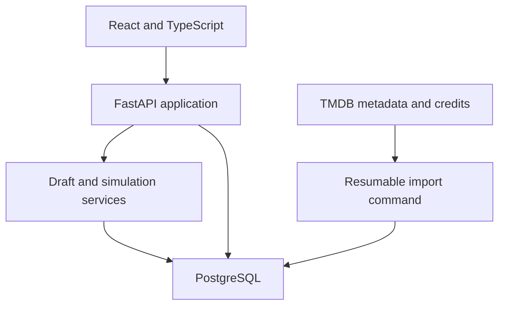

> Original Phase 1 architecture notes. The current implementation is described in [Phase 2 summary](phase-02/summary.md).

# Architecture and migration notes

## Current runnable package

The browser loads `index.html`, `styles.css`, `engine.js` and `app.js`. `engine.js` exposes pure-ish rule helpers and curated data; `app.js` owns state and rendering. localStorage is the only persistence. `scripts/serve.cjs` is a development file server, not a game API. Runtime and tests use only Node built-ins.

## Planned full-stack structure

| Layer | Responsibility | Phase |
|---|---|---|
| React / TypeScript / Tailwind | Accessible screens, candidate evidence, pending states; no official score authority | Foundation 2, gameplay polish 9 |
| FastAPI / Pydantic | Typed requests, ownership, state transitions, error contracts | 2–3, 7, 10 |
| PostgreSQL / SQLAlchemy / Alembic | Normalized credits, snapshots, actions and saved results | 2–3 onward |
| Import command | Source access, pacing, retry, normalization and quality reports | 4 |
| Feature/pricing functions | Versioned game metrics and fictional fees | 5 |
| Collaboration joins/graph | Shared-credit evidence and capped bonuses | 6 |
| Draft service | Exact completion feasibility, persistent offers and atomic commands | 7 |
| Simulation service | Frozen-input results and paired comparisons | 8, 11 |
| Analytics views | Real/synthetic event separation and product insight | 12 |

Use one backend and one relational database initially. PostgreSQL relationships are sufficient for the first collaboration graph; add NetworkX where it helps computation, not as a required second database. Do not require Redis, queues, Kubernetes or cloud hosting for the foundation.

## Suggested migration layout for Phase 2

Keep this root prototype as the baseline until explicitly migrating its commands. Add `frontend/`, `backend/`, `data/`, `tests/` and `docs/` with clear ownership. React can initially provide a minimal health-check screen while the existing root prototype remains separately runnable. Later route compatible behavior through the server, one workflow at a time. Document any root npm-script change so `npm start` does not silently stop opening the demo.

Preserve original fixtures and existing verification results before migration. Use a new storage schema/key for full-stack game state. Credentials go to backend environment variables; never add TMDB tokens to browser bundles. Commit `.env.example` with placeholders only. Introduce containers and pinned framework dependencies when implementing Phase 2, not as unused setup obstacles in this Phase 1 ZIP.

## Version boundary

New rules must identify dataset, pricing, features, role mapping, notable ranking, scoring, PRNG, rule and simulation versions. Snapshot outputs and their inputs. The frontend displays a draft's stored versions; it cannot recompute official results from a newly updated live catalog. This boundary is central to trustworthy what-if comparisons later.
