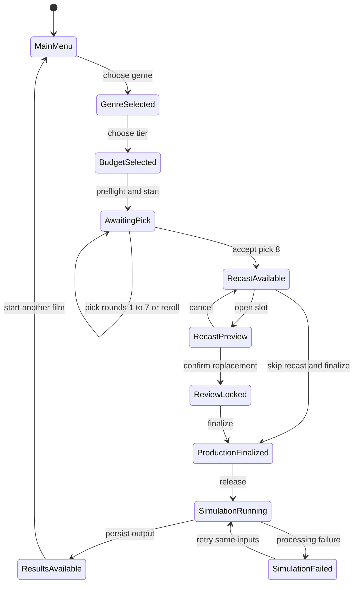

# Phase 1 — Game state, transactions and edge cases

Future authoritative state design. The bundled prototype has only local setup/draft/review/results screens and does not implement these backend guarantees.

## State machine

Main Menu and Genre Selected are client setup states. Budget Selected becomes a persisted draft only when catalog preflight and creation succeed. “Draft Started” is a creation event, “Draft In Progress” is a category containing the waiting states, and “Draft Completed” is an event entering Recast Available; do not persist redundant booleans that can disagree with the actual state.

Main Menu can restore a saved draft directly into its persisted state. Setup can move backward before creation. Abandoning an unfinished draft requires explicit confirmation and records `abandoned` as a terminal status. A new draft receives a new ID; it does not erase completed films. Simulation failure never reopens drafting.

## Transition table

| From | Command | Preconditions | Atomic effect / next state |
|---|---|---|---|
| Budget Selected | Create | Valid genre/tier; catalog has feasible complete assignment | Lock versions/config/seed; zero picks; persist first offer / Awaiting Pick |
| Awaiting Pick | Pick | Current offer and slot; unused identity; role valid; assignment feasible; matching version | Add person and fee; increment state version; generate next offer or enter Recast Available |
| Awaiting Pick | Reroll | Fewer than two consumed; changed valid offer possible | Persist changed offer and increment count/version; no roster or balance changes |
| Recast Available | Preview | Valid filled slot; no prior confirmed recast | Cache deterministic alternatives; preserve roster / Recast Preview |
| Recast Preview | Cancel | Preview exists | Close preview only / Recast Available |
| Recast Preview | Confirm | Candidate in cached offer; unique; affordable using old fee refund | Replace atomically, consume one recast, invalidate other previews / Review Locked |
| Recast Available or Review Locked | Finalize | Eight unique, eligible, affordable people; no pending preview | Freeze input snapshot / Production Finalized |
| Production Finalized | Release | No existing simulation job/result | Start once / Simulation Running |
| Simulation Running | Success | Result matches frozen input hash and simulation version | Persist one result / Results Available |
| Simulation Failed | Retry | Frozen inputs unchanged | Retry same simulation identity, seed and version / Simulation Running |

The future API should reject invalid transitions with a structured error and the current recoverable state. Distinguish stale-state conflicts from validation failures. No runtime backend endpoints are provided in Phase 1; these command contracts guide Phase 3 API design and Phase 7 engine implementation.

## Persisted state and concurrency

Draft record: ID, owner/guest capability reference, status, genre, budget tier, integer budgets and spend, slot order, picked identities/fees, current offer ID, recast previews, rerolls used, recast used, seed, PRNG version, dataset/rating/ranking/pricing/scoring/rules versions, state revision and timestamps. Snapshot inputs at finalization; persist the action history and output hash for replay diagnostics.

Each mutation supplies draft ID, expected revision and a client-generated request ID. In one transaction lock the draft row or compare-and-swap its revision, validate, apply the command and persist its response. Idempotency scope is `(draft_id, command_type, request_id)`. Same request and same body returns the saved response without another charge; same key with a different body rejects. A stale revision returns a conflict, prompting a state refresh. No money moves in a separate unguarded request.

Ignore browser-supplied fees, roles, score values, remaining allowance and catalog changes. Persist server-generated offer IDs and candidates. Authorization and guest-draft ownership checks must precede every future read/mutation; a guessable draft ID is not ownership. Local Phase 0 storage is not suitable for trusted leaderboards.

## Edge-case matrix

| Case | Required handling | Acceptance observation |
|---|---|---|
| Duplicate candidate in one hand | Deduplicate by person ID before sampling | Three IDs differ, or a short hand is explicitly shown |
| Already drafted person offered | Remove used identities across all roles | No identity can be picked a second time |
| Multi-role person | Keep distinct role profiles but one identity | Director pick blocks later writer pick of same person |
| Pick fee exceeds balance | Disable/reject | Spend and revision unchanged on failure |
| Pick leaves insufficient completion money | Exact matching check rejects | A cheap current choice can still be invalid if it consumes a unique future-role person |
| No legal continuation at creation | Fail preflight before accepting draft | No attempt or reroll charged |
| No affordable candidate mid-draft | Preserve state; diagnose snapshot/invariant error; retry or safely repair under same rules | No silent budget increase or auto-abandonment |
| Only one or two people in role pool | Show fewer cards honestly if continuation exists | No duplicates or invented identities |
| Missing portrait or poster | Local placeholder | Text and controls remain available |
| Incomplete filmography | Show verified works and coverage warning | No claims that catalog covers entire career |
| Fewer than five verified films | Show available count | Three source films produce exactly three work rows |
| Multiple matching credits on one film | Merge job labels for display, count film once | No repeated title in top five or double chemistry bonus |
| No role-specific credits | Exclude that role profile | Known-for metadata cannot substitute |
| Missing votes or rating | Display unavailable; use disclosed prior internally | Prior is never shown as a TMDB audience rating |
| Reroll with no changed valid hand | Disable and retain allowance | Counter unchanged |
| Reroll with partial novelty | Replace as many candidates as feasible | A changed hand consumes exactly one allowance |
| Reroll after roster complete | Reject | Completed draft untouched |
| Recast preview | Retain original person until confirmed | Displayed committed spend remains unchanged |
| Cancel recast | Remove preview UI only | Full original roster, money and allowance remain |
| Reopen recast | Reuse cached alternatives | No unlimited free offers by canceling |
| Recast already used | Reject subsequent replacement | Exactly one confirmed recast per draft |
| Recast candidate appears elsewhere | Reject by identity | Eight distinct people retained |
| Refresh or reconnect | Fetch persisted state and current offer | No new seed, reroll or cost |
| Double-click / retried request | Idempotent command | One pick, one charge, one revision advance |
| Two tabs mutate same draft | Revision conflict for the loser | No mixed offers or double spending |
| Incomplete roster finalized | Reject with missing slot list | No simulation started |
| Identical seed, snapshot, config and actions | Same offers and output | Replay comparison succeeds |
| Same seed but different dataset/actions | Treat as different input | Never promise matching results from seed alone |
| Data import changes mid-draft | Existing snapshot remains frozen | Old fees and eligibility remain stable |
| Simulation timeout | Retry frozen simulation ID | No result reroll or duplicate filmography entry |
| Browser storage full/unavailable in prototype | Inform user; in-memory play continues | Do not promise durable local save |

## Budget validation fixtures

1. **Direct overspend:** balance $600K, candidate $700K → reject before any mutation.
2. **Remaining jobs:** balance $1M, candidate $800K, cheapest feasible remaining assignment $250K → reject; $750K candidate is exactly legal.
3. **Unique identity trap:** remaining writer and composer, person A eligible for both at $100K; person B writer-only $400K; person C composer-only $500K. Independent minima report $200K incorrectly. True minimum is B as writer plus A as composer = $500K. With $400K left, reject.
4. **No full matching:** two remaining jobs, only A can do either → infeasible at any budget, not a cheap completion.
5. **Last pick:** $125K remaining, final composer $125K → accept, zero balance. $125,001 → reject regardless of rounded display.
6. **Recast:** remaining $200K and old fee $500K → replacement capacity $700K. A $650K replacement leaves $50K. Cancel leaves $200K, old person and old fee.
7. **Reserve protection:** Indie talent spend $6.5M is full even though the separate $3.5M reserve still exists; no further paid talent purchase is possible without a refund.
8. **Duplicate request:** submit the same valid $650K recast twice with one idempotency key → one replacement and one $150K net charge.

These are future automated-test specifications. `npm test` currently verifies the legacy prototype's own budgets and rules, not these new fixtures.
