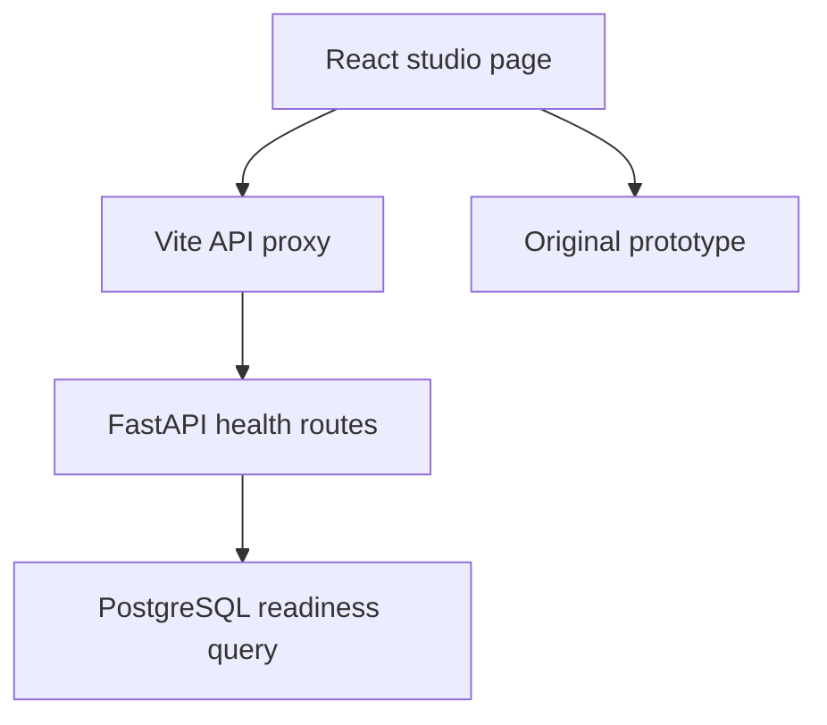

# Phase 2 — Full-stack foundation

Implementation milestone: React + TypeScript + Vite + Tailwind frontend; FastAPI backend; validated settings; PostgreSQL connection layer; Docker Compose; Alembic baseline; tests; dependency locks and CI. The original four gameplay assets are unchanged.

## Implemented components

| Component | Location | Behavior |
|---|---|---|
| React studio shell | frontend/src/App.tsx | Calls health endpoints, displays independent API/DB states, retries, and links to the original game |
| Typed HTTP helper | frontend/src/api.ts | Runtime-checks response shape, handles failures, timeout and cancellation |
| Design preview | config/game-design.json | Integer-dollar tiers, eight unique slots, two rerolls, one recast, five notable works; explicitly planned metadata |
| API factory | backend/app/main.py | Typed liveness/readiness, request IDs, safe error envelope, explicit development CORS |
| Settings | backend/app/config.py | Reads backend/.env, validates required fields/ports/origins, keeps the password private |
| PostgreSQL adapter | backend/app/database.py | SQLAlchemy + psycopg, finite connection/pool/statement timeouts, real SELECT 1 readiness |
| Alembic setup | backend/migrations | Empty declarative base and migration environment; no domain schema invented |
| Environment generator | scripts/setup-env.cjs | Generates a local password, creates missing env files, preserves existing files |
| Local stack | compose.yaml | PostgreSQL, API, Vite and original prototype; ports bind to loopback |
| CI | .github/workflows/ci.yml | Frontend/legacy checks and a backend job with a PostgreSQL service |

No TMDB calls, database domain models, talent computation, collaboration graph, authoritative drafting, replacement simulator or accounts were added. Budget cards preview the Phase 1 design; they do not alter legacy game rules. The existing root startup command still opens the original prototype.

## Architecture now

The prototype remains independent and stores its own old localStorage state. The React shell does not read or rewrite those saves. Backend credentials are never injected into browser code. Only the public prototype URL is a `VITE_` variable.

## Dependency policy

Frontend direct versions are exact pins; `frontend/package-lock.json` records the resolved dependency tree. Backend direct dependencies are exact pins and `backend/requirements.lock` constrains transitive dependencies, including a Windows-specific colorama pin. The declared application runtime is Python 3.12 and Node 24.x (24.15+); tested versions are recorded in verification.md.

Container base images use explicit major/distribution tags (`postgres:17-bookworm`, `node:24-bookworm-slim`, `python:3.12-slim-bookworm`). These tags receive patch updates; they are not digest-pinned reproducible images. Application dependency lockfiles are included. Rebuild and verify when changing any of these versions.

## Exit criteria and limits

- [x] Preserved and rechecked the working original prototype.
- [x] Added the planned frontend/backend/data/config structure.
- [x] Built and type-checked the React shell.
- [x] Demonstrated a live request from Vite through its proxy to FastAPI.
- [x] Added honest connected/unavailable health states and recovery tests.
- [x] Validated startup settings and explicit CORS behavior.
- [x] Added SQLAlchemy PostgreSQL connectivity and a dedicated real-DB integration test.
- [x] Initialized Alembic without premature domain tables.
- [x] Added local/Docker setup, pinned dependencies and CI configuration.
- [ ] Execute real PostgreSQL integration in a running local DB or CI environment.
- [ ] Execute the full Docker Compose build/start on a Docker-capable machine.
- [ ] Perform browser visual/keyboard checks on desktop and mobile.

The remaining checks are environment verification gates, not implemented features that can be claimed as tested. This environment has no Docker, could not install system PostgreSQL, and could not obtain a working browser executable. See the exact results in [verification.md](verification.md).

## Handoff to Phase 3

Run the full local setup and get both status cards connected first. Phase 3 defines the normalized movie/person/credit model, versioned game snapshots and application API contracts. Use [phase-03-handoff.md](../phase-03-handoff.md); preserve the UI and health checks while adding migrations.
