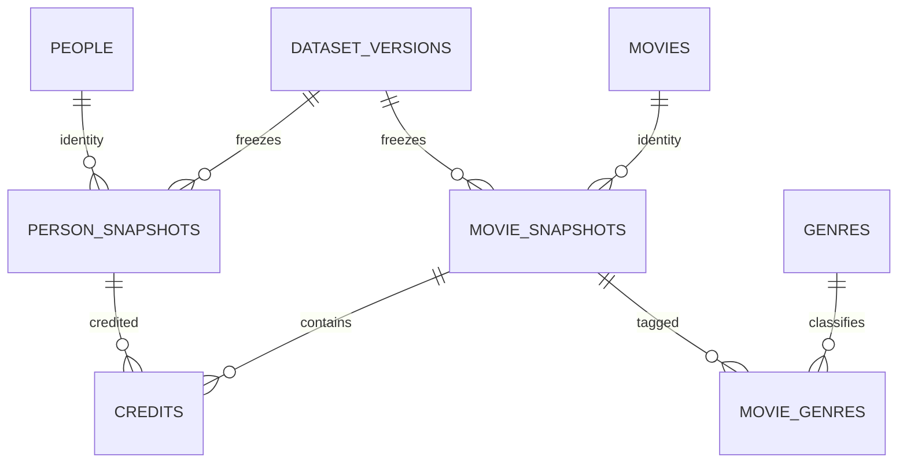
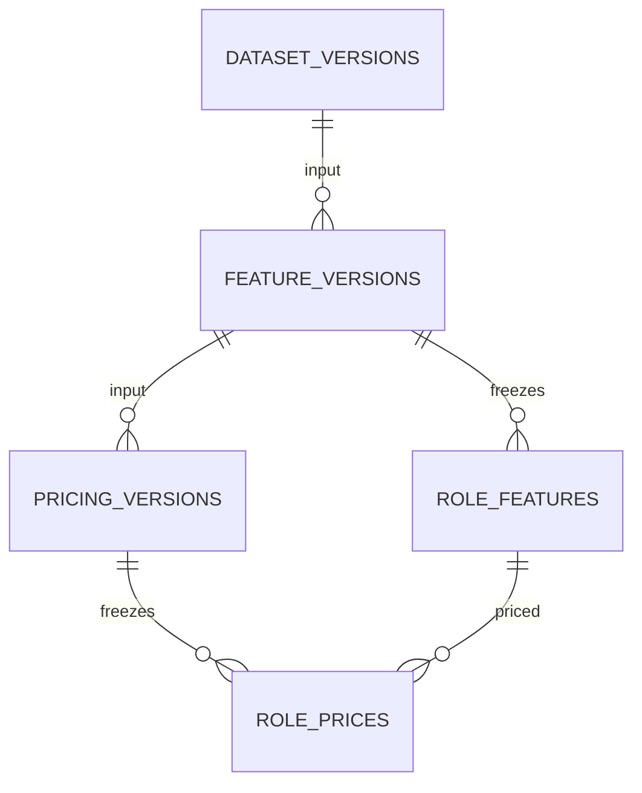
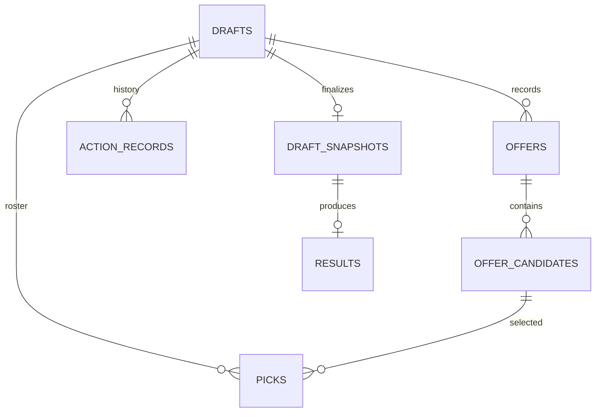

# Database design — Phase 3

This schema is PostgreSQL-specific: UUID identities, JSONB snapshots, BIGINT dollars, timestamptz timestamps, composite foreign keys and PL/pgSQL immutability guards. Alembic revision `0001_phase3` contains frozen explicit DDL; it never imports evolving application models.

## Catalog and derived data

| Table | Purpose and key rules |
|---|---|
| `people`, `movies` | Stable UUID identity; unique source + source key. Synthetic keys must start `fixture:`; TMDB keys must be actual positive numeric source IDs supplied later by the importer |
| `genres` | Stable canonical slug and unique name; Science Fiction has one slug |
| `dataset_versions` | Scope/mapping versions, provenance and immutable import configuration |
| `person_snapshots` | Dataset + person key; frozen name, optional image/popularity and coverage |
| `movie_snapshots` | Dataset + movie key; source fields, eligibility decision/reason and provenance; unknown fields remain NULL |
| `movie_genres` | Dataset-scoped many-to-many relation |
| `credits` | Person/movie must belong to the same dataset; original job/kind/department/character retained; normalized role may be NULL when excluded/unmapped |
| `feature_versions`, `role_features` | Separate game attributes/evidence per person and professional role, with an explicit ranking version |
| `pricing_versions`, `role_prices` | Separate fictional integer-dollar prices; one fee per person/role/version, shared across tiers |
| `rules_versions`, `scoring_versions` | Frozen configuration for each rules/scoring revision |

Credit deduplication uses unique `(dataset_id, source_credit_id)` when supplied and a unique `(dataset_id, dedupe_key)` in all cases. Phase 4 must build `dedupe_key` from provider credit ID or a canonical hash of `(person, movie, kind, job, character)`. NULL source IDs are permitted. Distinct jobs survive deduplication; downstream film lists still deduplicate by movie ID.

One person can have director and writer profiles. Actor slots use the same `actor` profile. A credit alone is source evidence; talent strength and fictional prices belong to the separate derived tables. The role-feature insert guard requires at least one matching credit on an eligible movie. The exact source job mapping and source validation belong to the importer, not to a broad database string match.

## Sealing and reproducibility

Version rows begin `sealed=false`. Insert their member rows, then update **only** `sealed` to true in the same transaction. A database trigger permits that one-way transition and rejects other version updates/deletes. Members are append-only even during staging; once sealed, new member inserts are blocked too. The member guard locks the parent row, preventing a concurrent seal from racing an insert.

Feature versions require an already sealed dataset; pricing versions require sealed features. Draft creation requires sealed dataset, feature, pricing, rules and scoring versions. Composite foreign keys prevent a pricing version from being mixed with the wrong feature or dataset. Failed imports can roll back their transaction; a future checkpointing importer should keep staging/checkpoints outside these immutable published records.

`content_hash` on a version is the SHA-256 of its stored configuration/manifest object, **not a claim that it hashes every relational row**. Phase 4 should include source export checksums in its dataset manifest. Final `input_hash` covers the complete serialized frozen game input; `output_hash` covers the saved result payload. Hashing is Python UTF-8 JSON with sorted keys, compact separators, `ensure_ascii=False`, and non-finite numbers rejected. A cross-language implementation must reproduce that encoding; this is not RFC 8785 canonicalization.

## Draft persistence

| Table | Safeguards |
|---|---|
| `drafts` | Exact tier budgets; 35% reserve; spending in [0, talent envelope]; bounded reroll/recast counters; frozen identity, seed and version references |
| `offers` | Slot, pick/recast kind, revision and RNG position; sealed after its candidates are persisted |
| `offer_candidates` | Unique person and position within offer; at most positions 1–3; locked fictional role price must match the draft's pricing version; source/game card snapshot |
| `picks` | One row per draft/slot, unique draft/person; composite FK ties offer to same draft and slot; candidate/fee FK prevents substituted price; sealed selectable candidate required |
| `action_records` | Immutable successful request/response records; unique draft/command/request ID and draft/revision-after; body hash; one revision advance |
| `draft_snapshots` | One final input per draft; immutable JSON and hash; typed repository validation checks eight people/slots, fees, persisted picks and versions |
| `results` | One result and simulation identity per draft; composite FK requires exact snapshot hash; immutable result payload/hash |

Indexes support person-role credits, movie credits, and owner/date draft lookup. Composite primary/unique keys support snapshot and version joins. Foreign keys use restrictive deletion; no cascade can silently remove historical game data.

`owner_key_hash` is a storage field for a future verified owner/guest capability reference. The fixture value is not an authentication token. No draft read/write HTTP endpoints are exposed now. Authorization must be implemented before exposing them.

A recast will update the current `picks` row transactionally; original selections remain in immutable offers and action responses. Once a final snapshot exists, pick changes are rejected. Cached recast offers are retained; the Phase 7 state service will select the active offer and invalidate old preview choices logically.

## Enforcement boundaries

The database enforces identity, references, per-row budgets, price equality, sealed inputs and uniqueness. Pydantic validates strict dollar types, response accounting, film-list limits and frozen roster consistency. BIGINT alone cannot reject every SQL client's numeric cast, so clients must use typed API/repository boundaries rather than trusting browser values.

The complete state machine, pick count versus state, aggregate draft-spend reconciliation on each mutation, exact minimum-cost completion, reroll novelty, current-offer selection, idempotent command transaction and ownership checks are **Phase 7 service responsibilities**. They are not claimed as implemented by these constraints. JSONB does not validate arbitrary card/evidence internals on direct SQL writes; use typed contracts and repositories. Database owners can alter/drop triggers; this is application integrity, not protection against database administrators.
