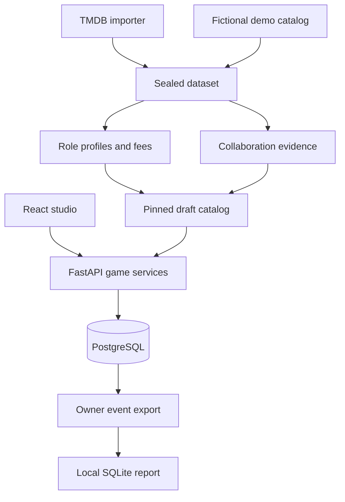
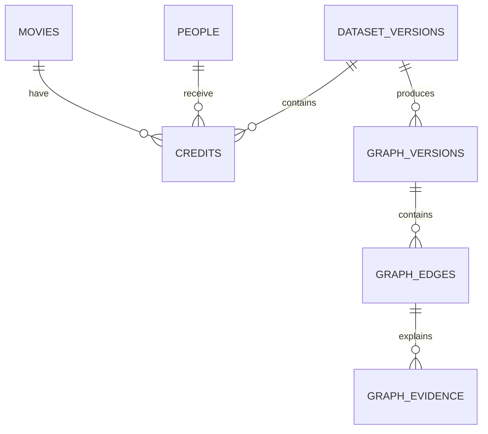
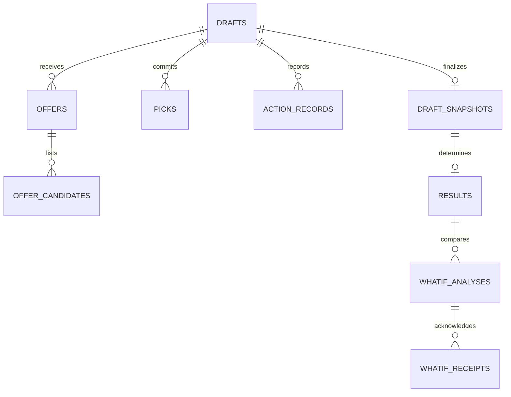

# How a movie becomes a reproducible game result

A player chooses a genre and a budget, then hires eight distinct people. The server owns available offers, eligibility, prices and score. Film credits explain two decisions a reviewer can inspect: which works a card shows, and which credited collaborations earn chemistry points.

The nodes show responsibilities, not separately deployed microservices. PostgreSQL also stores the sealed datasets, derived versions and catalog; the arrows above focus on what each stage consumes. Import and demo builders run explicitly. Drafting and release read pinned local data without calling TMDB. The optional local SQLite report does not serve requests from the game API.

## Why the picks stay feasible

One person may both direct and write, but cannot occupy two roster slots. A cheap director may be the only viable writer. Before marking a card selectable, the service asks whether the *remaining* roles can be filled by different, affordable people. A minimum-cost matching algorithm processes one identity at a time and tracks which slots are already occupied. If the director is needed elsewhere, the server can block the card and explain why. For a concrete example run `python -m scripts.assignment_example` from `backend/`.

[Solver and witness](../../backend/app/drafting/assignment.py) · [Offer rules](../../backend/app/drafting/rules.py) · [Offer validation and mutation receipts](../../backend/app/drafting/service.py)

## Where evidence and history live

These are selected actual table names. The complete model has 42 application tables; Alembic's `alembic_version` is separate.

A graph node identifies a person *in a role*. An edge joins two different people and counts distinct shared films. Evidence records retain movie IDs and each participant's exact credited job. Absence means no shared credit in this dataset. It does not establish that two people never worked together. Price and popularity are fictional game inputs, not real hiring estimates.

A mutation carries a request ID and expected revision. An exact retry after a lost response returns the saved receipt. A reused ID with a different body or a stale revision is rejected. Ownership is checked on the server. Finalization freezes inputs and hashes them; release stores one official result with its input identity. A what-if substitutes one role in a separate comparison and applies identical noise draws to both teams in each of 64 scenarios. It cannot replace the official result. Challenge reports remain hidden until the deadline.

[Models and constraints](../../backend/app/models.py) · [Release arithmetic](../../backend/app/simulation/engine.py) · [Paired comparison](../../backend/app/whatif/engine.py) · [Audit-friendly analytics](../../backend/app/analytics/mart.py)

## What runs on the developer's computer

| Process | Responsibility | Local boundary |
|---|---|---|
| React/Vite | Render the studio, send commands, restore saved state | `localhost:5174`; `/api` proxied to FastAPI |
| FastAPI | Validate ownership, apply transitions, return reports | `localhost:8001`; `/api/docs` describes the live contract |
| PostgreSQL 17 | Transactions, identities, catalogs, immutable receipts and results | Host `127.0.0.1:5433`; containers connect to `db:5432` |
| Original prototype | Earlier standalone game | `localhost:5500`; separate from authoritative studio |
| Offline tools | Reproduce a synthetic film, audit experiments, generate reports | Terminal; the worked-film tour never writes gameplay records |

The local Compose stack is the demo runtime. A Git repository or downloadable ZIP contains source and instructions; neither runs the Python service or PostgreSQL on its own.
