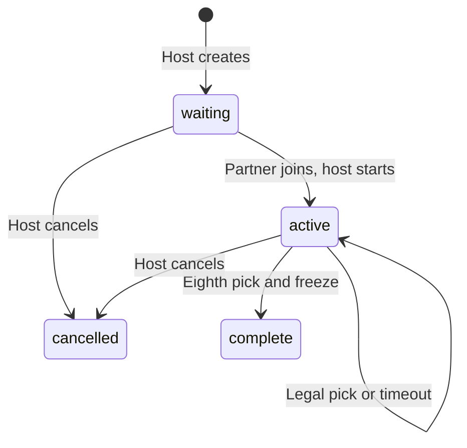

# Cooperative rooms: design and protocol

Phase 15 implements one shared film for exactly two player identities. Seat 0 is the host and acts at pick indices 0, 2, 4, 6; seat 1 acts at 1, 3, 5, 7. Role order and fictional hiring economics come from the existing classic engine. The host's catalog is pinned when the room is created. No random seed, fee or role order is accepted from clients.

## State and ownership

A room owns one unique draft link, two stable guest-owner references, invitation hash, creation request/hash/receipt, room revision, deadline, turn duration and at most eight pick events. Account authentication resolves the account's owned guest references, including claimed sessions. The two seats are separate owner identities; this is not proof of two distinct humans. An account that later owns both guest identities can control both; it is a cooperative local game, with no competitive ranking claim.

The host owns the normal draft, snapshot and eventual release. The partner receives a room view containing the current offer, roster, budget and pick history; it contains neither player tokens nor internal owner IDs. They do not gain general access to the host's draft APIs. The invite admits one second identity and never authorizes reading a joined room by itself. The server stores SHA-256 of the 32-byte random invitation; the browser keeps the plaintext only in memory. Requests mask the secret in model serialization; command fingerprints incorporate its digest. There is no invite recovery service or room directory.

## Commit and timeout rules

HTTP mutations authorize the session, lock the room with `FOR UPDATE`, verify membership and any existing receipt, validate the expected room revision, then lock the linked draft. Shared drafting calls the same `mutate_in_session` code used by solo drafting, inside the room's transaction. Pick legality is recomputed with the pinned pool and exact minimum-completion solver. The offer, pick, spend, next offer, room event, next deadline and room receipt commit together. The eighth pick also finalizes the existing `phase7-v1` frozen snapshot in that transaction.

The room revision is distinct from the draft revision. Join and start change room revision without making a draft pick. The eighth room pick also increments draft revision for finalization. Clients send **room revision** on room commands; the service supplies draft revision internally. The solo mutation route refuses all room films with `room_managed`. Existing solo algorithms and pricing/scoring manifests remain unchanged.

Each successful mutating room request is keyed by `(room_id, request_id)` and fingerprints the action plus complete body. Reuse with another action/body or another actor fails. Duplicate success returns the original receipt even after later turns. The browser then fetches current state and refuses lower room or draft revisions from delayed messages. A failed GET after a successful POST does not trigger another mutation. Creation is serialized on the host and has its own exact receipt; the underlying solo creation request is namespaced and cannot attach an existing solo draft.

At API startup an asynchronous task runs a sweep once per second. Each sweep locks up to 20 overdue active rooms with `SKIP LOCKED`, then locks each linked draft. Multiple API processes can run this sweep without selecting a room simultaneously. Each room uses a savepoint so a failed room does not roll back unrelated timeout picks in the batch. Failures log a room ID without tokens or database credentials. The next sweep retries a failed room; a broken catalog needs operator attention.

The database's `clock_timestamp()` after lock acquisition determines expiry. At equality the manual pick is too late. A timeout selects the cheapest **selectable offered** person, ties by stable person ID; it does not search beyond that offer. It uses the same legality checks as a player. The next deadline is set from completion time plus the configured duration. Restarting after a long outage advances one overdue turn per affected room, then grants a full turn; missed time never cascades eight immediate selections. API downtime delays the sweep, and normal workload can delay it beyond one second. The UI's timer never causes a write.

## HTTP and WebSocket contract

Every HTTP room operation uses the existing Authorization bearer session. Errors use the normal envelope and private HTTP responses have `Cache-Control: no-store`. Request/response schemas are included in [current OpenAPI](../../contracts/openapi.current.json).

| Route | Purpose | Required body |
|---|---|---|
| `POST /api/v1/rooms` | Create a waiting room and new host-owned draft | `request_id`, `genre_id`, `tier`, `invite_code`; optional `turn_seconds` (30–180, default 60), existing classic `mode` |
| `POST /api/v1/rooms/{id}/join` | Occupy the second seat | `request_id`, `invite_code` |
| `GET /api/v1/rooms/{id}` | Read a full current snapshot as a member | None |
| `POST /api/v1/rooms/{id}/start` | Host starts after partner joins | `request_id`, `expected_revision` |
| `POST /api/v1/rooms/{id}/picks` | Current seat picks | Above plus `offer_id`, `person_id` |
| `POST /api/v1/rooms/{id}/cancel` | Host abandons an unfinished shared film | `request_id`, `expected_revision` |
| `WS /api/v1/rooms/{id}/live` | Receive current snapshots | First text frame only: `{"token":"YOUR_PRIVATE_SESSION"}` |

WebSocket origin must exactly match an entry in `CORS_ORIGINS`. URL query parameters are rejected so credentials cannot be put in a URL. The first frame must arrive within five seconds and is limited to 256 characters after decoding. It must have only the token field. The socket never accepts gameplay commands; further inbound messages close it. The API authenticates and reads membership again for every snapshot, so expired/revoked credentials close the stream. Clients receive `{"type":"room","room":...}` about once per second. Bad credentials/protocol close with 1008; database unavailability closes with 1013.

Updates poll PostgreSQL inside the server and are pushed over a genuine WebSocket. There is no process-local game state or in-memory broadcast authority to lose on restart. This simple choice also works across API workers without Redis, at the cost of repeated database reads. Every reconnect gets a full snapshot; there is no incremental event cursor to replay. Browser reconnection backs off up to eight seconds and uses HTTP reads while the socket is disconnected. The Vite `/api` proxy enables WebSocket upgrades and preserves the browser's origin.

## Boundaries and follow-up

There are two participants, no spectators, no host transfer, no seat replacement, no ready/away state, no chat and no competitive rooms. A disconnected or expired player does not pause the game; automatic picks let it finish. One person is exclusive within the shared roster, not globally across rooms. Completed rosters are frozen with no recast. The partner's financial report remains a future UI/API extension. The existing host analytics export describes underlying classic commands without per-player attribution; keep cooperative playtests in their own cohort instead of mixing them with solo observations.

This is a local development application. WebSocket connection limits, account quotas, load certification, TLS reverse-proxy configuration and public hosting are not included. Do not infer a production concurrency capacity from mocked browser tests. Read the [verification ledger](verification.md) before making performance or database claims.

Implementation references: [FastAPI WebSockets](https://fastapi.tiangolo.com/advanced/websockets/), [PostgreSQL 17 explicit locking](https://www.postgresql.org/docs/17/explicit-locking.html), and [websockets releases](https://github.com/python-websockets/websockets/releases). The application-specific policies and limits above are CineDraft's choices.
